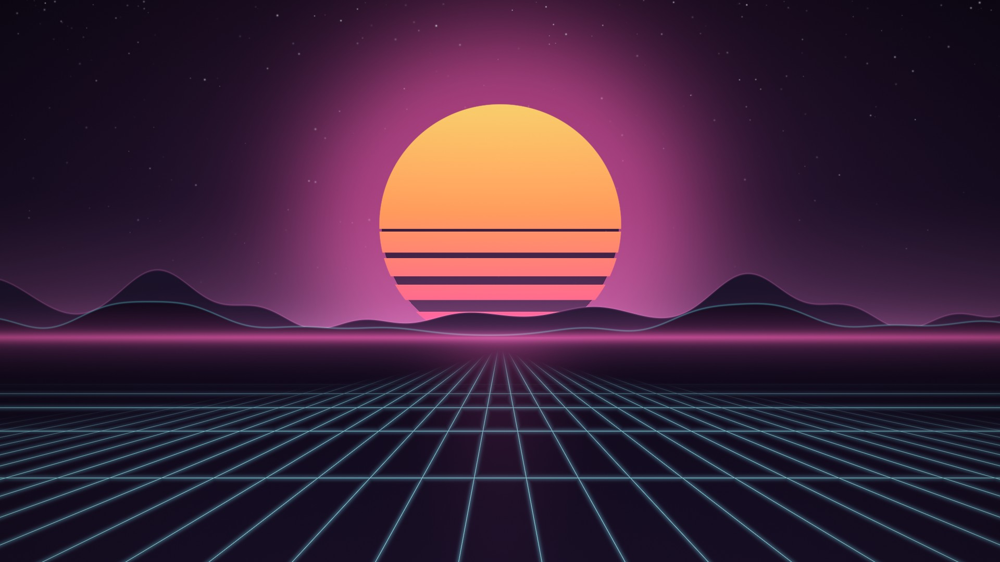

# Livewall

Animated, palette-matched wallpapers for Hyprland / Omarchy. Livewall follows the
active Omarchy theme and plays that theme's seamless loop on the wallpaper layer.
It pauses while a window is fullscreen or the machine is on battery. If there is
no scene for the theme, no player is installed, or you ran `livewall set static`,
it draws nothing and your normal static background shows.



Preview clip: [`scenes/neon-horizon/loop-1080p.webm`](scenes/neon-horizon/loop-1080p.webm).

## Requirements

- Hyprland (Omarchy for automatic theme following)
- Python 3.11+
- One player:
  - **mpvpaper** (recommended), or
  - GTK4 + gtk4-layer-shell + PyGObject (the bundled `renderer/livewall_gtk.py`),
    which plays video through GStreamer, so it also needs `gst-plugins-good` and an
    H.264 decoder (`gst-libav` or `gst-plugin-va`), or
  - **swww**, for GIF scenes only

`install.sh` tells you if a player or GStreamer plugin is missing.

## Install

```bash
git clone https://github.com/Blackshield-Company/livewall.git
cd livewall
./install.sh            # install for the current user
./install.sh --enable   # same, and also enable + start the systemd user unit
```

The installer needs no root and touches only these paths:

| Path | What |
|---|---|
| `~/.local/share/livewall/` | the program, GTK player, built-in scenes, README |
| `~/.local/bin/livewall` | the `livewall` command |
| `~/.config/systemd/user/livewall.service` | systemd user unit (skip with `--no-systemd`) |

Plain `./install.sh` copies the unit but doesn't enable it, so nothing runs until
you `livewall start` (or install with `--enable`). It will not overwrite an
existing `~/.local/bin/livewall` that isn't Livewall's. Make sure `~/.local/bin`
is on your `PATH`.

At run time Livewall also uses `~/.config/livewall/` (config, chosen scene, your
scenes) and `~/.local/state/livewall/livewall.log`.

## Usage

```
livewall start [--foreground] [--no-systemd]   start the daemon
livewall stop                                  stop; the static background returns
livewall status [--json]                       what is playing and why
livewall list                                  installed scenes (* = current)
livewall set <scene> | auto | static           pick a scene, follow the theme, or turn off
livewall config                                create/print ~/.config/livewall/config.toml
```

The scene is picked by theme name first (`theme.name` or the `current/theme` symlink,
or `$LIVEWALL_THEME`), then by palette (`[match]` keys compared with the theme's
`colors.toml`).

`livewall config` writes a commented default config. Options: `backend`
(`auto`, `mpvpaper`, `gtk`, `swww`, `static`), `layer` (`bottom` or `background`),
`pause_on_fullscreen`, `pause_on_battery`, `resolution` (`auto` or e.g. `3840x2160`),
`poll_interval` and `mpv_options`.

## Scenes

| Scene | Theme | Loops | Source |
|---|---|---|---|
| `neon-horizon` | Neon Horizon | 1080p, 2160p (8 s, 30 fps) | fully procedural, `generators/neon_horizon.py` |

A scene is a folder with a `scene.toml`:

```toml
name = "my-scene"
theme = "my-theme"            # or themes = ["a", "b"]
fps = 30
poster = "poster.jpg"         # optional still
[video]                       # or video = "loop.mp4", or frames = "frames/", or gif = "loop.gif"
1920x1080 = "loop-1080p.mp4"
3840x2160 = "loop-2160p.mp4"
[match]                       # optional palette fallback
background = "#1a1029"
```

Media paths must stay inside the scene folder. Put your own scenes in
`~/.config/livewall/scenes/` and packs (`pack.toml` + `scenes/`) in
`~/.config/livewall/packs/`. Your scenes win over built-ins with the same name.

## Uninstall

```bash
./uninstall.sh
```

This stops Livewall, disables and removes the systemd unit, and deletes only
the files `install.sh` put in place. Your `~/.config/livewall/` (config and own
scenes), the log, and anything you added to `~/.local/share/livewall/` yourself
are kept. Delete those by hand if you want them gone.

## Rebuilding the media

You need `ffmpeg`, `numpy` and `Pillow`, plus the Neon Horizon theme's `colors.toml`.
Every loop renders frame *i* at t = i/N so it wraps without a jump. Check that with
`generators/check_seam.py loop.mp4`: a seam no larger than the max frame step means no
visible jump. The generators use `$LIVEWALL_THREADS` (default 2) for both render
processes and ffmpeg. 4K takes about 2 GB per process and about 7 minutes with 2.

```bash
C=~/.config/omarchy/themes/neon-horizon/colors.toml
nice -n 19 python3 generators/neon_horizon.py --colors $C --out scenes/neon-horizon/loop-1080p.mp4
nice -n 19 python3 generators/neon_horizon.py --colors $C --size 3840x2160 --out scenes/neon-horizon/loop-2160p.mp4
generators/make_previews.sh $C    # previews/{hero.png,preview.webm,preview.mp4}
```

## Tests

```bash
python3 -m unittest discover -s tests -v
```

No Hyprland, mpv or battery is needed. Hyprland and sysfs are faked.

## License

MIT. See [LICENSE](LICENSE).
